# Kickstarter ML Service

Сервис машинного обучения для предсказания успешности Kickstarter-проектов. Построен на базе FastAPI, упакован в Docker и развертывается в Kubernetes (Kind) через GitHub Actions. Использует DVC для версионирования данных и MLflow для управления жизненным циклом моделей. Регулярное переобучение модели в Airflow, сама модель - логрег с регуляризацией. Данные: [кагл](https://www.kaggle.com/datasets/kemical/kickstarter-projects)

# Quickstart

## Репозиторий и зависимости

``` bash
git clone https://github.com/Teodorus730/ml_service.git
cd ml_service

uv sync
```

## Данные

Датасеты по [ссылке](https://www.kaggle.com/datasets/kemical/kickstarter-projects), основной ks-projects-201801.csv, оба в папку /data/. 

Изменение рабочего датасета

data/make_split.py
scripts/traffic.py
dags/retrain_dag.py
src/kickstarter/data.py
src/kickstarter/train.py

## Образы Docker

``` bash
docker pull apache/airflow:3.3.2

docker pull ghcr.io/mlflow/mlflow:v3.16.1

docker pull ghcr.io/actions/actions-runner:2.337.0

docker pull rustfs/rustfs:1.0.0
```

## ML Платформа

``` bash
bash platform/up.sh

uv run dvc remote modify --local laptop access_key_id dvcadmin

uv run dvc remote modify --local laptop secret_access_key dvc-secret-123

uv run dvc push
```

### Изменить данные (добавить в конец срез 2016) - опционально

Запуск (при условии что в папке data лежат оба датасета с кагла https://www.kaggle.com/datasets/kemical/kickstarter-projects)

``` bash
uv run python data/make_split.py
```

Проверка

``` bash
MLFLOW_TRACKING_URI=http://mlflow.localhost uv run python -m kickstarter.data
```

Пуш в dvc

``` bash
uv run dvc add data/ks-projects-201801.csv
git add data/ks-projects-201801.csv.dvc
git commit -m "update dataset: added mock updates"
uv run dvc push
```

## Обучение модели

``` bash
MLFLOW_TRACKING_URI=http://mlflow.localhost C=1 uv run python -m kickstarter.train
```

## Деплой сервиса

Из форка на гитхабе Settings - Actions - Runners - New self-hosted runner

На машине (REPO_URL и RUNNER_TOKEN свои)

``` bash
MSYS_NO_PATHCONV=1 docker run -d --name gh-runner \
  --network kind \
  --group-add 0 \
  --restart unless-stopped \
  -v /var/run/docker.sock:/var/run/docker.sock \
  -e REPO_URL="" \
  -e RUNNER_TOKEN="" \
  ghcr.io/actions/actions-runner:2.337.0 \
  bash -c '[ ! -f .runner ] && ./config.sh --unattended --url "$REPO_URL" --token "$RUNNER_TOKEN" --name platform-kind --labels "kind"; exec ./run.sh'
```

На гитхабе Actions - ci - run workflow

## Запросы

Тестовый (good.json)

``` bash
curl -X POST http://kickstarter.localhost/v1/predict -H "Content‐Type: application/json" -d @good.json
```

Запуск трафика (scripts/traffic.py)

``` bash
uv run python scripts/traffic.py --url http://kickstarter.localhost --rps 5 --bad 0.05
```

## Переобучение модели Airflow

Даг запускается 1 и 15 числа каждого месяца в 3:00. Можно запустить руками airflow.localhost

## Grafana

Дашборд Kickstarter Service, можно пронаблюдать за трафиком

# Схема системы

Ниже представлена архитектура развертывания и взаимодействия компонентов.

```mermaid
graph TD
    subgraph Client ["Пользователь (Внешний доступ)"]
        User["Клиент"]
        MLOpsUser["MLE"]
    end

    subgraph K8s ["Kind\nВнешний вход: 127.0.0.1:80 → Traefik:30080"]
        Ingress["Traefik Ingress\nВнутренний порт: 30080\nМаршрутизация (*.localhost)"]
        SVC["kickstarter-service\nFastAPI Pod\nВнутренний: kickstarter-service:80 (target 8000)"]
        DB[("PostgreSQL\nТаблица: predictions\nВнутренний: postgres:5432\n(Без внешнего доступа)")]
        MLflow["MLflow Server\nРеестр моделей\nВнешний: http://mlflow.localhost\nВнутренний: mlflow.mlops:5000"]
        S3["RustFS (S3-compatible)\nВнешний: http://s3.localhost (API), http://s3-console.localhost (UI)\nВнутренний: rustfs.mlops:9000 / 9001"]
        Grafana["Grafana\nМониторинг\nВнешний: http://grafana.localhost\nВнутренний: monitoring-grafana:80"]
    end

    subgraph MLOps ["CI/CD & MLOps (Внешние и гибридные сервисы)"]
        GH["GitHub Repository\nhttps://github.com/Teodorus730/ml_service/"]
        GHA["GitHub Actions Runner\nlabels: self-hosted, kind\n(Выполняет kubectl, dvc, docker build)"]
        GHCR[("GHCR\nDocker Images:\nghcr.io/teodorus730/ml_service/...")]
        DVC[("DVC Remote\nS3: http://s3.localhost (снаружи)\nS3: rustfs.mlops:9000 (кластер)")]
        Airflow["Airflow\nRetrain DAG\nВнешний: http://airflow.localhost\nВнутренний: airflow.mlops:8080"]
    end

    %% Пользовательские запросы
    User -->|"HTTP POST /v1/predict\n(kickstarter.localhost:80)"| Ingress
    MLOpsUser -->|"Управление и мониторинг\n(*.localhost:80)"| Ingress
    
    %% Маршрутизация Ingress (по Host header)
    Ingress -->|"host: kickstarter.localhost"| SVC
    Ingress -->|"host: mlflow.localhost"| MLflow
    Ingress -->|"host: airflow.localhost"| Airflow
    Ingress -->|"host: grafana.localhost"| Grafana
    Ingress -->|"host: s3.localhost / s3-console.localhost"| S3

    %% Внутренние взаимодействия K8s
    SVC -->|"Загрузка модели\n(mlflow.mlops:5000)"| MLflow
    SVC -->|"Сохранение request_id, score, latency\n(postgres:5432)"| DB
    SVC -.->|"Чтение данных/моделей\n(rustfs.mlops:9000)"| S3
    
    %% CI/CD Pipeline
    GH -->|"workflow_dispatch / push"| GHA
    GHA -->|"build & push"| GHCR
    GHA -->|"kubectl apply -f k8s/"| Ingress
    GHCR -.->|"pull image"| SVC
    
    %% MLOps и данные
    GHA -->|"dvc pull / push"| DVC
    Airflow -->|"dvc pull (обучение)"| DVC
    Airflow -->|"train & log metrics\n(mlflow.mlops:5000)"| MLflow
    DVC -.->|"Хранение артефактов и данных"| S3

    %% Стилизация для наглядности
    classDef external fill:#500000,stroke:#333,stroke-width:2px;
    classDef k8s fill:#005000,stroke:#333,stroke-width:2px;
    classDef mlops fill:#000050,stroke:#333,stroke-width:2px;
    
    class User,MLOpsUser,GH,GHCR external;
    class Ingress,SVC,DB,MLflow,S3,Grafana k8s;
    class GHA,DVC,Airflow mlops;
```



| Сервис | Внешний адрес (Host) | Внутренний адрес (K8s DNS) | Порт | Примечание |
| :--- | :--- | :--- | :--- | :--- |
| **Traefik Ingress** | `127.0.0.1:80` | `traefik.traefik:30080` | `80 → 30080` | Маппинг портов настроен в `kind-config.yaml` |
| **Kickstarter API** | `http://kickstarter.localhost` | `kickstarter-service:80` | `80` (target `8000`) | Основной FastAPI-сервис |
| **MLflow** | `http://mlflow.localhost` | `mlflow.mlops:5000` | `5000` | Реестр моделей и метрик |
| **Airflow** | `http://airflow.localhost` | `airflow.mlops:8080` | `8080` | Оркестрация DAG-ов (переобучение) |
| **Grafana** | `http://grafana.localhost` | `monitoring-grafana:80` | `80` | Дашборды мониторинга (логин: `admin`/`admin`) |
| **S3 (RustFS) API** | `http://s3.localhost` | `rustfs.mlops:9000` | `9000` | Хранилище для DVC и артефактов MLflow |
| **S3 (RustFS) Console** | `http://s3-console.localhost` | `rustfs.mlops:9001` | `9001` | Веб-интерфейс управления бакетами |
| **PostgreSQL** | *Нет (только внутри кластера)* | `postgres:5432` | `5432` | База данных для сохранения предсказаний |

# Данные

| Артефакт | Где хранится | Как найти нужную версию |
| --- | --- | --- |
| Код | Git (GitHub) | По хешу коммита (git rev-parse HEAD) или тегу релиза.|
| Данные | DVC Remote (S3: s3.localhost) | По хешу в файле .dvc, хэш в гите = хэш в mlflow |
| Модель | MLflow | По run_id или зарегистрированному алиасу версии (например, champion или kickstarter-v1) в UI MLflow. |
| Образ (Docker) | GHCR | По тегу образа, который формируется CI как sha-<GITHUB_SHA>. |
| Логи запросов | PostgreSQL (БД kickstarter, таблица predictions) | По request_id из ответа json |
