# Итоговая схема системы

---

# Схема системы

Ниже представлена архитектура развертывания и взаимодействия компонентов.

```mermaid
graph TD
    subgraph Client ["Пользователь (Внешний доступ)"]
        User["Клиент"]
        MLOpsUser["MLE"]
    end

    subgraph K8s ["Kind\nВнешний вход: 127.0.0.1:80 → Traefik:30080"]
        Ingress["Traefik Ingress\nВнутренний порт: 30080\nМаршрутизация (*.localhost)"]
        SVC["kickstarter-service\nFastAPI Pod\nВнутренний: kickstarter-service:80 (target 8000)"]
        DB[("PostgreSQL\nТаблица: predictions\nВнутренний: postgres:5432\n(Без внешнего доступа)")]
        MLflow["MLflow Server\nРеестр моделей\nВнешний: http://mlflow.localhost\nВнутренний: mlflow.mlops:5000"]
        S3["RustFS (S3-compatible)\nВнешний: http://s3.localhost (API), http://s3-console.localhost (UI)\nВнутренний: rustfs.mlops:9000 / 9001"]
        Grafana["Grafana\nМониторинг\nВнешний: http://grafana.localhost\nВнутренний: monitoring-grafana:80"]
    end

    subgraph MLOps ["CI/CD & MLOps (Внешние и гибридные сервисы)"]
        GH["GitHub Repository\nhttps://github.com/Teodorus730/ml_service/"]
        GHA["GitHub Actions Runner\nlabels: self-hosted, kind\n(Выполняет kubectl, dvc, docker build)"]
        GHCR[("GHCR\nDocker Images:\nghcr.io/teodorus730/ml_service/...")]
        DVC[("DVC Remote\nS3: http://s3.localhost (снаружи)\nS3: rustfs.mlops:9000 (кластер)")]
        Airflow["Airflow\nRetrain DAG\nВнешний: http://airflow.localhost\nВнутренний: airflow.mlops:8080"]
    end

    %% Пользовательские запросы
    User -->|"HTTP POST /v1/predict\n(kickstarter.localhost:80)"| Ingress
    MLOpsUser -->|"Управление и мониторинг\n(*.localhost:80)"| Ingress
    
    %% Маршрутизация Ingress (по Host header)
    Ingress -->|"host: kickstarter.localhost"| SVC
    Ingress -->|"host: mlflow.localhost"| MLflow
    Ingress -->|"host: airflow.localhost"| Airflow
    Ingress -->|"host: grafana.localhost"| Grafana
    Ingress -->|"host: s3.localhost / s3-console.localhost"| S3

    %% Внутренние взаимодействия K8s
    SVC -->|"Загрузка модели\n(mlflow.mlops:5000)"| MLflow
    SVC -->|"Сохранение request_id, score, latency\n(postgres:5432)"| DB
    SVC -.->|"Чтение данных/моделей\n(rustfs.mlops:9000)"| S3
    
    %% CI/CD Pipeline
    GH -->|"workflow_dispatch / push"| GHA
    GHA -->|"build & push"| GHCR
    GHA -->|"kubectl apply -f k8s/"| Ingress
    GHCR -.->|"pull image"| SVC
    
    %% MLOps и данные
    GHA -->|"dvc pull / push"| DVC
    Airflow -->|"dvc pull (обучение)"| DVC
    Airflow -->|"train & log metrics\n(mlflow.mlops:5000)"| MLflow
    DVC -.->|"Хранение артефактов и данных"| S3

    %% Стилизация для наглядности
    classDef external fill:#500000,stroke:#333,stroke-width:2px;
    classDef k8s fill:#005000,stroke:#333,stroke-width:2px;
    classDef mlops fill:#000050,stroke:#333,stroke-width:2px;
    
    class User,MLOpsUser,GH,GHCR external;
    class Ingress,SVC,DB,MLflow,S3,Grafana k8s;
    class GHA,DVC,Airflow mlops;
```

| Сервис | Внешний адрес (Host) | Внутренний адрес (K8s DNS) | Порт | Примечание |
| :--- | :--- | :--- | :--- | :--- |
| **Traefik Ingress** | `127.0.0.1:80` | `traefik.traefik:30080` | `80 → 30080` | Маппинг портов настроен в `kind-config.yaml` |
| **Kickstarter API** | `http://kickstarter.localhost` | `kickstarter-service:80` | `80` (target `8000`) | Основной FastAPI-сервис |
| **MLflow** | `http://mlflow.localhost` | `mlflow.mlops:5000` | `5000` | Реестр моделей и метрик |
| **Airflow** | `http://airflow.localhost` | `airflow.mlops:8080` | `8080` | Оркестрация DAG-ов (переобучение) |
| **Grafana** | `http://grafana.localhost` | `monitoring-grafana:80` | `80` | Дашборды мониторинга (логин: `admin`/`admin`) |
| **S3 (RustFS) API** | `http://s3.localhost` | `rustfs.mlops:9000` | `9000` | Хранилище для DVC и артефактов MLflow |
| **S3 (RustFS) Console** | `http://s3-console.localhost` | `rustfs.mlops:9001` | `9001` | Веб-интерфейс управления бакетами |
| **PostgreSQL** | *Нет (только внутри кластера)* | `postgres:5432` | `5432` | База данных для сохранения предсказаний |

# Данные

| Артефакт | Где хранится | Как найти нужную версию |
| --- | --- | --- |
| Код | Git (GitHub) | По хешу коммита (git rev-parse HEAD) или тегу релиза.|
| Данные | DVC Remote (S3: s3.localhost) | По хешу в файле .dvc, хэш в гите = хэш в mlflow |
| Модель | MLflow | По run_id или зарегистрированному алиасу версии (например, champion или kickstarter-v1) в UI MLflow. |
| Образ (Docker) | GHCR | По тегу образа, который формируется CI как sha-<GITHUB_SHA>. |
| Логи запросов | PostgreSQL (БД kickstarter, таблица predictions) | По request_id из ответа json |

# Правки после ревью

добавил MIN_GAIN 0.1

# Пункты

# 1. Полный деплой

Удалил кластер, все образы (docker system prune -a), датасеты. С полного нуля до трафика прошло 40 минут, но я пару раз отвлекался (сдвгшник) и интернет не насовский. 

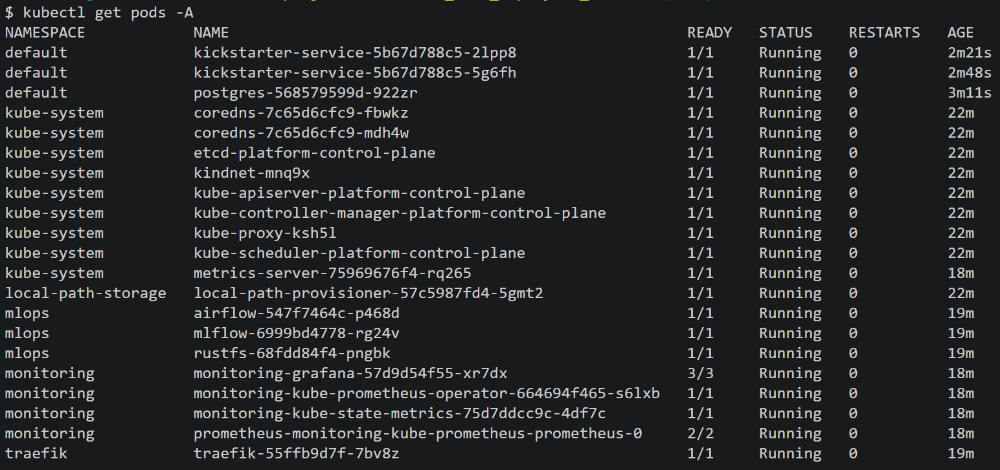

# 2. Метрики

Метрики работают, рестарты тоже тянутся (проверял), hpa работает (видно по графику задержки)

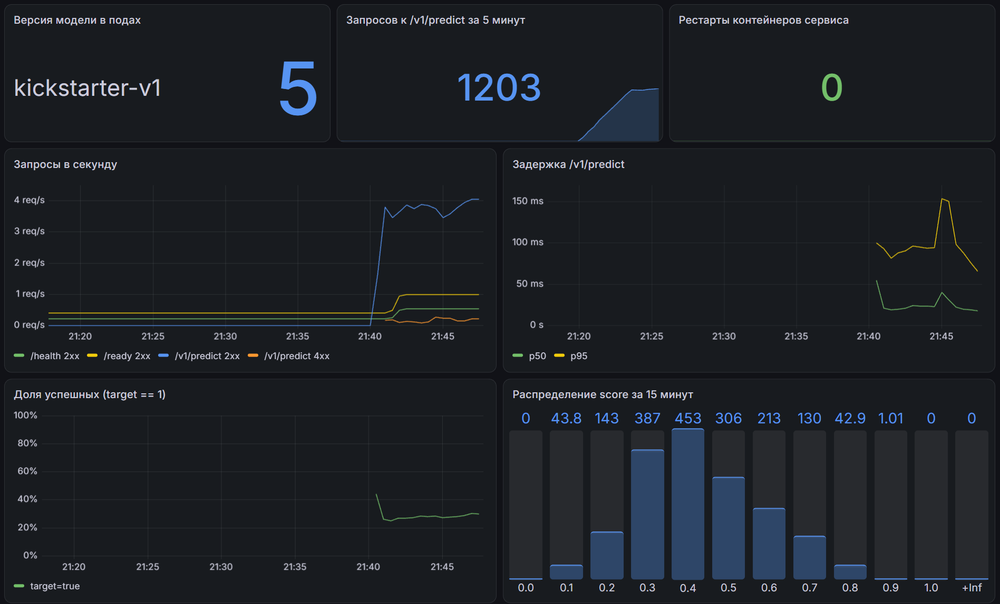

# 3. DVC

Не понял про docker run, пока так если че хранилище есть

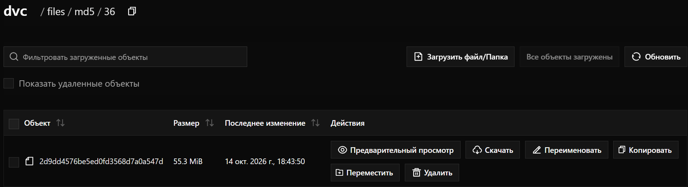

# 4. Данные и очистка

Взял другой срез датасета (за 2016 год), по сути сырые данные, как мок подойдет. Идея такая: данные пришли от другого сервиса (намучался я с apify, не заработало), нужно дообучать модель чтобы следить за трендами, устранять концепт дрифт. Да данные приходят не новые, а наоборот, более старые, но это мок 

ФАЙЛ make_split.py 

Оставил 3 строки в датасете, валидация не прошла

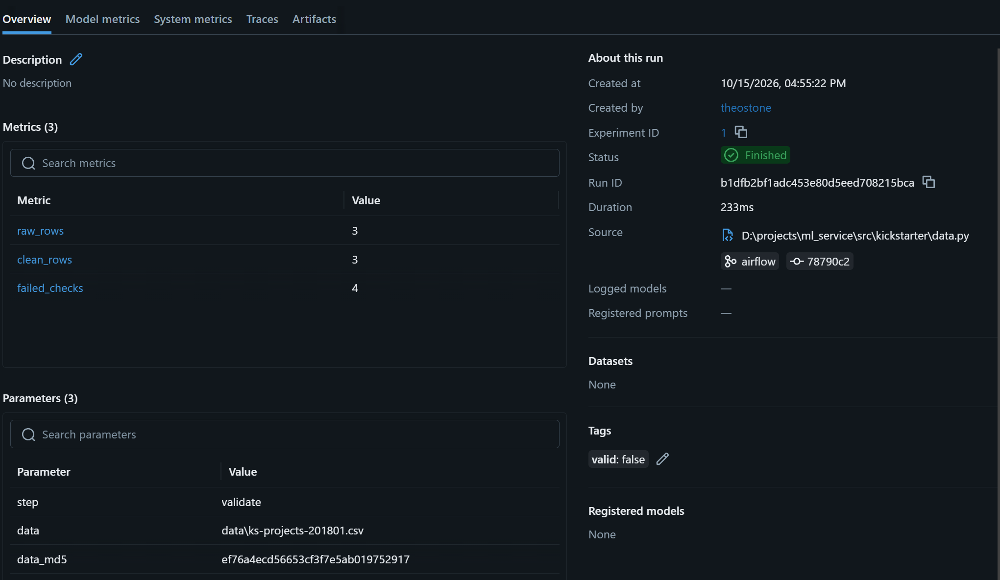

Зеленый ci с тестами

https://github.com/Teodorus730/ml_service/actions/runs/38770580458

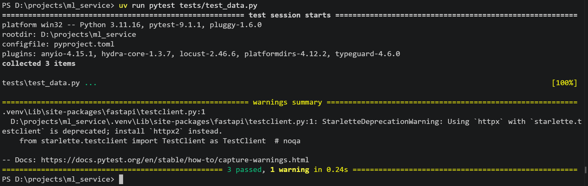

# 5. Airflow

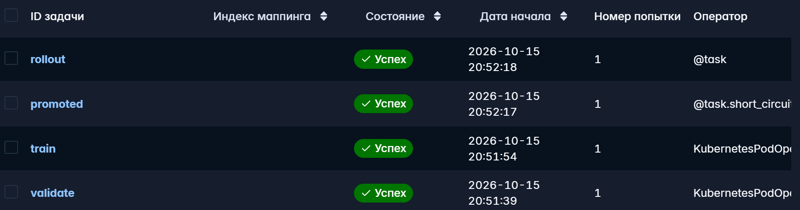
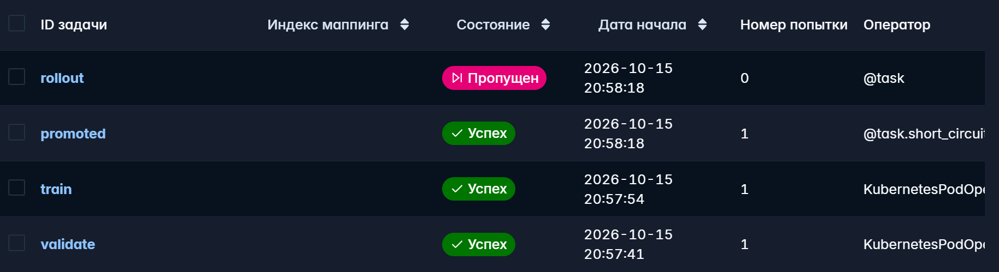
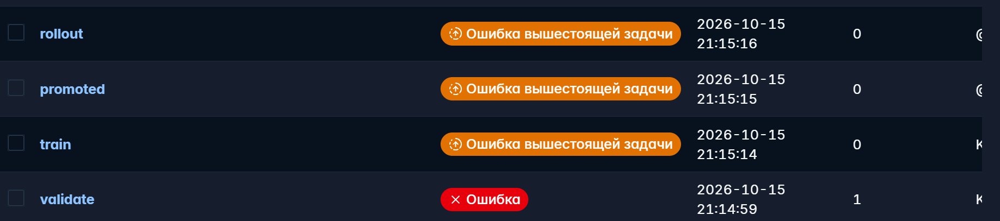

Версия в графане меняется, стало v2

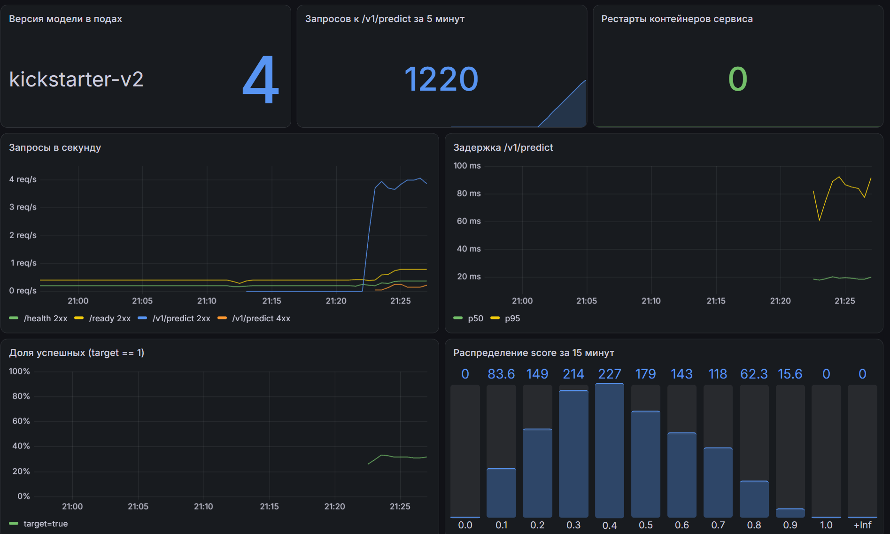

В регистри чемпион у 2 запуска (первый запуск под airflow)

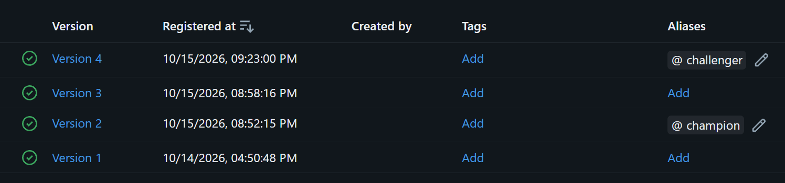

# 6. CICD под ранером

Ну вот последний прогон, в принципе я вообще все под реннером делал

https://github.com/Teodorus730/ml_service/actions/runs/38784500945

# Проблемы

Поменял файл дашборда и забыл убрать запятую у последнего элемента в списке. Json невалидный, графана его не читает - дашборда нет. Применяю манифесты, перезапустил ворквлоу, пересобрал с нуля кластер - нет дашборда. ошибок нет, все зеленое и дашборда тоже нет. в итоге только с нейронкой нашел запятую эту, 2 часа ушло

# Вопросы

1. В regisrty смотрим md5 датасета, он же в гите. 

2. Данные не в образе потому что тяжелые. без указателей в образе данные не получить. если git push раньше dvc push в прод попадёт указатель на данные, которых ещё нет в хранилище, и dvc pull в поде упадёт.

3. Проверок в схеме дофига, в основном копируют схему из апи. Из прикольного добавил проверку валют (собрал по датасету все возможноые варианты, если придет что то новое - потенциальное падение при конвертации usd_goal_real)

4. Пандера проверяет датафрейм, работает со статистикой и большим количеством данных. Pydantic проверяет пользовательский ввод (жсон), основная цель - проверить типы данных и наличие полей. 

5. Потому что airflow это оркестратор (сервис короче), у него свои лимиты, у обучения свои. Часто обучение надо запускать на гпу, самому airflow гпу не нужен - поднимается отдельный воркер. Пересборка не требуется потому что модель тянется из mlflow, ее нет в образе

6. Севрис - запросы, RPS и latancy. Инфраструктура - рестарты. Модель - версия, распределение таргета и скоров

7. При загрузке новой модели кубер создает новые поды и опрокидывает старые, при этом запросы могут какое то время идти на старый удаленный под - bad gateway. Для этого preStop: удаление происходит с задержкой, под удаляется позже чем пропадает из эндпоинтов.

8. Самый вероятный отказ в проде - кривые данные. нужно тестирование на реальных пользователях, которые отправляют всяякую чушь, уверен что косяков много. Любые ошибки апи можно заметить в дашборде api, но вот найти конкретные причины будет довольно сложно (если под упал, не факт что будет даже запись в бд со статусом запроса, а другого логирования по сути и нет). Если косяк все таки сформулируется, он просто летит в схему pydantic на валидацию и все ок

# Для себя

## Удаление файла из dvc

uv run dvc remove data/ks-projects-201801-50k.csv.dvc

git rm data/ks-projects-201801-50k.csv.dvc

rm data/ks-projects-201801-50k.csv

uv run dvc gc -w # Garbage Collection
